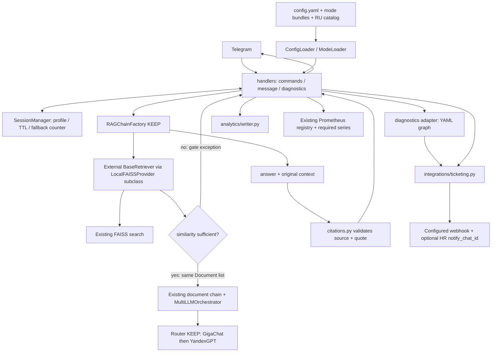

# G1b — архитектурный план Onboarding Navigator

Автор: Architect Agent. Статус: **G1b approved by user; amended plan refinement prepared**, только корректировка плана. Входы: `acceptance_criteria.yaml` (35 AC), `repo_map.json`, `baseline_report.md`, `change_proposal.md`, `architect_input.json`, `u01_provenance_check.json`, `i18n_literal_audit.json` в `.agent/artifacts/`. AC и исходники не изменены. G1b утверждён пользователем; текущая версия уточняет согласованные зоны и пути. Эта корректировка не начинает реализацию или G2.

## Решение по U01: A

**Provenance доступен через существующий контракт: путь `Document.metadata["source"]` + `Document.page_content`. AC-U01 активен, mandatory, включён в MVP и план файлов.** Последний запрос пользователя допускает `chunk_id / page_content`; native `chunk_id` не создаётся и его наличие не заявляется. Сохраняем исходное условие AC-U01 без изменения текста AC. Если впоследствии понадобится именно native chunk_id, это отдельное изменение требований, не повод менять защищённое ядро.

Статические доказательства, относительно корня HR-проекта:

- [rag_chains.py:271](../../workspace/telegram-rag-bot/telegram_rag_bot/langchain_adapter/rag_chains.py#L271): `TextLoader` и `split_documents`; строки 288–292 — `page_content`, `metadata.source`.
- [rag_chains.py:333](../../workspace/telegram-rag-bot/telegram_rag_bot/langchain_adapter/rag_chains.py#L333): передача metadata в FAISS; ветвь `from_documents` также сохраняет metadata исходного TextLoader.
- [rag_chains.py:512](../../workspace/telegram-rag-bot/telegram_rag_bot/langchain_adapter/rag_chains.py#L512): `create_retrieval_chain(retriever, document_chain)`, кэширование и return без проекции только answer.
- [retrieval.py:64](../../workspace/telegram-rag-bot/langchain_classic/chains/retrieval.py#L64): `RunnablePassthrough.assign(context=...).assign(answer=...)` возвращает реально использованные документы и ответ.
- [handlers.py:628](../../workspace/telegram-rag-bot-src/telegram_rag_bot/handlers.py#L628): сейчас handler берёт только `response["answer"]`; именно разрешённый handler сохраняет `response["context"]` для citation adapter. Используется `chain.invoke` в worker thread (строка 558); контракт также допускает `ainvoke`.

Это проверка доступности контракта, не подтверждение 12/12 runtime-тестов. Цитата извлекается исключительно из **того же** `response.context`, который использован document chain. Повторный поиск, восстановление источника из текста LLM, вывод недоступного absolute path и реконструкция цитаты запрещены. Разрешённые canonical source paths и display_name задаются YAML, для UI только название источника. Проверяется дословный фрагмент, содержащий ожидаемый FAQ-факт; неизвестный источник/нет подходящего совпадения → локализованное «основание недоступно». Low-score ответ обрабатывается AC-S6, цитата не добавляется.

## Компоненты и границы

| Действие | Компонент | Решение |
|---|---|---|
| keep | `RAGChainFactory`, `langchain_adapter/rag_chains.py` | Без изменения байтов, prompt, chunking и LCEL сборки; public `create_chain`, `rebuild_index` сохраняются. |
| keep | `orchestrator/router.py`, `orchestrator/retrieval/async_faiss.py` | Ни правок, ни копирования/подмены реализации; GigaChat→YandexGPT выполняет существующий Router. |
| keep | embeddings, базовый LocalFAISSProvider, vectorstore factory, CLI | Сохраняем совместимость и существующие контракты. |
| adapt | source `main.py`, `handlers.py`, `mode_loader.py`, `config_loader.py`, `utils/session_manager.py`, `utils/metrics.py` | Wiring внешних adapters, context preservation, сценарии/команды, загрузка YAML, TTL и наблюдаемость. |
| add | `telegram_rag_bot/hr_adapter.py` в source checkout | Внешняя subclass/facade FAISS, score gate, multi-source coordinator; никакого rewrite RAG. |
| add | `telegram_rag_bot/citations.py`, `diagnostics.py`, `i18n.py` в source checkout | Проверка цитат; детерминированные YAML-развилки; lookup RU-строк. |
| add | root `integrations/ticketing.py`, `analytics/writer.py` | Продуктовый application layer с webhook и обезличенным JSONL. Это точные root paths из задачи, не файлы установленной зависимости. |
| adapt/add | root `config/`, Docker/K8s, тесты и `tests/load/` | Тексты/политики и настройки, deployment и проверяемость 35 AC. |
| rewrite | нет | Возможности расширения достаточны; защищённое ядро не переписывается. |

## Реальные extension boundaries: score и источники без изменения RAG

`RAGChainFactory.__init__` сейчас создаёт provider через factory; bootstrap имеет доступ к `rag_factory.embeddings_provider`, `vectorstore_provider`, `chains` и `modes`. Внешняя настройка до первой `create_chain` заменяет provider на **subclass LocalFAISSProvider**, сохраняя `isinstance(..., LocalFAISSProvider)` в защищённом коде. Новый `hr_adapter.py` не заменяет RAGChainFactory.

Subclass `load_index(mode)` делегирует загрузку существующему `LocalFAISSProvider.load_index`, возвращает facade с `as_retriever(search_kwargs)` и прозрачным forwarding оставшихся свойств FAISS (`index`, docstore и т.д.). Его retriever — `langchain_core.retrievers.BaseRetriever`, вызывающий нативный `FAISS.similarity_search_with_score(query,k=3)` **один раз**. Документы копируются с исходным source/page_content и добавленными score metadata, без мутации общего docstore. Для L2 расстояния d>=0 similarity=1/(1+d), clamp/валидация [0,1]; NaN/неподдержанная distance metric/пустой контекст обрабатываются fail closed. Threshold берётся из `rag.score_threshold`, default 0.65. При top similarity ниже threshold retriever выбрасывает отдельное typed исключение с безопасными score/candidates, которое handler распознаёт как RAG-fallback. Это происходит **до вызова document chain/LLM**, поэтому не возникает генерации без контекста. На успешном пути только прошедшие threshold документы попадают в возвращаемый context и LLM. Нативные score не обещаются существующим контрактом; это добавление адаптера.

Риск для Reuse: базовые `save_index`/`delete_index` вызывают `self.load_index.cache_clear()`. При override без lru_cache будет AttributeError; при двух cache слоях очистка только facade оставит stale базовый FAISS. Внешняя subclass должна сохранить cache_clear interface (например, cached override) и после save/delete явно инвалидировать **оба** слоя: `LocalFAISSProvider.load_index.cache_clear()` и собственный cached load_index, вместе с chains cache. Приёмочный тест: reindex меняет контент и следующий поиск видит новую версию без restart. Это не требует правок базового provider.

Кэш provider и `rag_factory.chains` очищается на reindex; subclass сохраняет cache-clear поведение `save_index`/`delete_index` (публичные методы baseline), а не ломает вызов `self.load_index.cache_clear()`. До реализации интерфейс facade и исключение проверяются integration-тестом с реальной LCEL-сборкой и fake LLM. Нельзя заменять это двумя поисками и выдавать результаты второго за контекст первого. `retrieval.async_mode=false` сохраняется: текущая async ветвь фабрики передаёт `search_kwargs`, которого нет в constructor installed AsyncFAISSRetriever; защищённую несовместимость не исправляем.

Для AC-F02 внешний coordinator собирает Document из разрешённых Markdown-источников, использует существующий `RecursiveCharacterTextSplitter` с baseline настройками, существующий embedding provider и публичные `FAISS.from_documents`/`FAISS.from_embeddings`, `provider.save_index`; protected rebuild_index не редактирует. Это адаптация входных источников и storage interface, не новый retrieval algorithm. Каждый исходный документ сохраняет точный canonical source; нельзя объединять все Markdown в один synthetic FAQ и приписывать ему provenance исходников. `/reindex` и bootstrap направляются в coordinator; legacy `/reload_faq` сохраняется как совместимый alias к тому же процессу. Изоляция по mode, выбранному onboarding plan/department проверяется; произвольный user role не становится путём вне разрешённого plans root. После завершения индекс публикуется под блокировкой; последняя успешная версия остаётся доступной при ошибке. Индексы — только доверенные собственные файлы, не загруженные пользователем pickle.

## YAML-режимы и продуктовые adapters

Сохраняем `modes.directory` и обязательные `files.system_prompt` / `files.faq`. IT-bundle разбит в file plan на три явных adapt-файла data: `config/modes/it_support/mode.yaml` (optional source_titles/diagnostics_file с сохранением baseline полей), `config/modes/it_support/system_prompt.md` (уточнение HR-IT с сохранением структуры), `config/modes/it_support/faq.md` (три контрольных факта AC-S1: VPN, почта, Git). Отдельный четвёртый файл `config/modes/it_support/diagnostics.yaml` остаётся add/data; directory-level IT-разрешение удалено. Добавляются benefits, learning, culture, onboarding_plan с теми же `mode.yaml`, `system_prompt.md`, `faq.md`. Эти поля уже существуют: `name`, `display_name`, `description`, `enabled`, `files`, `timeout_seconds`. Новые поля являются **предлагаемым расширением** ModeLoader, не найденным API: `sources` (allowlisted paths/globs в пределах bundle), `source_titles` (source→label), `diagnostics_file` (it_support), `plans_directory` (onboarding_plan). Существующие bundles без новых полей продолжают работать.

- `config/modes/it_support/diagnostics.yaml`: сценарии vpn/mail, start node, question_key, choices→next, terminal FAQ reference; минимум 2 terminal branches/сценарий, путь ≤3 вопросов, запрет циклов/неизвестных ссылок. UI-строки в RU-каталоге; FAQ references — устойчивые ID/anchors утверждённых фактов. Каждый terminal либо показывает этот факт, либо предлагает эскалацию, и всё равно имеет FAQ reference. Явная эскалация прерывает любой шаг через AC-S7. Диагностика не запрашивает credentials, ничего не исполняет и не меняет RAG-counter.
- Onboarding: пользователь задаёт role/department, SessionManager хранит их с TTL 24ч от последнего ввода. Выбор `<role>__<department>.md` → `<role>.md` → «план не настроен» + default если есть + предложение эскалации; подтверждение создаёт reason explicit. Missing-plan JSONL обязателен независимо от optional обычного журнала.
- `config/config.yaml`: nonsensitive settings `rag.score_threshold=0.65`, `integrations.ticketing.url/hr_chat_id`, `i18n.default_locale=ru`, retrieval async false, ordered first-available GigaChat then YandexGPT, ADMIN_IDS whitelist и TTL86400. Секретные значения — только placeholders, снабжение runtime человеком из разрешённого им secret mechanism; агент не читает/не создаёт/не редактирует secret files. Здесь нет обязательной HR-system авторизации.
- `integrations/ticketing.py`: POST JSON exact AC-F05 fields; SHA256 ID, UUID retained across retries, ISO8601 UTC, 3 попытки с паузами 1/2/4 перед попытками и timeout5с каждая. Это фиксированное approved AC, не reinterpretation в 4 попытки. HTTP 2xx — успех; notify_chat_id в том же запросе, без него уведомления нет. Неуспех → RU-сообщение, masked ERROR, tickets_failed_total. Успех сбрасывает counter и increments tickets_created_total один раз. Повторные update обрабатываются с дедупликацией активного ticket_id на уровне сессии. Реальное создание заявок при планировании не выполняется.
- `analytics/writer.py`: общий redaction для логов/webhook/JSONL, serialised append валидных JSON-строк, UTC, reason missing_plan mandatory; обычный unanswered optional AC-O02. Generated runtime `analytics/unanswered.jsonl` в план commit не включён; никаких реальных запросов/персональных данных в fixtures. Редакторский отчёт U04 не создаётся.
- Метрики: существующий `utils/metrics.py` **adapt**, не новый параллельный registry. llm_requests_total, rag_score_bucket, fallback_total{type=rag|llm}, tickets_created_total и tickets_failed_total с bounded labels. LLM наблюдаемость через внешние provider decorators, делегирующие публичные `generate` и `health_check` и сохраняющие Router-алгоритм; request-local attempt state отличает реальное GigaChat→YandexGPT переключение от прямого вызова YandexGPT. Состояние health-cache и uptime хранятся в wiring, `/status` показывает ровно AC-F04, fail до первого health_check. API health_check вызывается с timeout, не из `/status`.

Root integrations и analytics — пакеты с `__init__.py`, прикладной слой deployment. Wheel из source checkout поставляет telegram_rag_bot; standalone wheel сам по себе **не** содержит root content/adapters. Docker копирует root application packages/config вместе с установкой собранного wheel, WORKDIR/PYTHONPATH root приложения. Local product invocation и tests задают тот же root import path. Запрещено случайно импортировать installed audit target вместо source-under-test; тестовый import origin фиксируется. Если в будущем требуется единый wheel продукта — это отдельное packaging решение, без скрытого копирования root packages в dependency tree сейчас.

## Расположение config/

Продуктовый config/ — ~/projects/hr_bot/config/ (корень проекта). Installed target config/ отсутствует. Baseline G0 подтверждён wheel-хешем 0.14.6.

Canonical absolute path продуктового каталога: `/Users/alesamarskij/projects/hr_bot/config`. Это root configuration приложения, а не `workspace/telegram-rag-bot/config`. Архитектурные ссылки `config/...` и пути file plan разрешаются от корня HR-проекта.

Уточнение provenance baseline: исторический G0 pass основан на успешной сборке и проверке метаданных wheel; прежний отчёт не заявлял сохранённый SHA256. **Текущий проверенный artifact** `workspace/telegram-rag-bot-src/dist/telegram_rag_bot-0.14.6-py3-none-any.whl` существует, его SHA256 теперь подтверждён: `71b28b1d3d4cb2ecfa0ea93ffc843f117711a16516dc46dd70d0519535061447`. Эта новая проверка целостности дополняет историческое основание G0, не переписывает его историю.

## Порядок зон

**backend-preflight → data → backend-rest → infra.** Это порядок будущей реализации после разрешённого перехода к ней; сейчас только документация, G2 не начинается. Поля stage в file plan не вводятся, owner_role остаётся backend/data/infra.

1. **backend-preflight — ровно три файла:** `config/config.yaml`, `config/i18n/ru.yaml`, `workspace/telegram-rag-bot-src/telegram_rag_bot/i18n.py`. Последний — canonical путь для пользовательского shorthand `telegram_rag_bot/i18n.py`; существующий путь file plan не меняется. Здесь подготавливаются механизм загрузки локали и RU-каталог/несекретная конфигурация, а не handler migration.
2. **data:** bundles, подтверждённые FAQ/планы/политики и YAML-диагностика в перечисленной зоне. IT-база уточняется тремя явными adapt-записями и отдельным add diagnostics.yaml. UI в data задаётся только RU key references; сами HR-факты остаются утверждёнными Markdown-источниками. При необходимости нового ключа data согласует его с backend-owner RU-каталога, не добавляет UI literals в код.
3. **backend-rest:** весь остальной backend, включая `handlers.py` и `mode_loader.py`, их миграцию i18n, AST-проверки и adapters. Эти файлы не переносятся в preflight. Ранее измеренные 47/6 логических кириллических выражений остаются оценкой объёма миграции, не результатом новых правок.
4. **infra:** Docker/K8s, load tooling и deploy-проверки после data/backend-rest. Keep-объекты никогда не становятся задачами редактирования.

**Traceability AC-C07 по зонам:** backend-preflight — `i18n.py` + `config/i18n/ru.yaml` для механизма/каталога и `config/config.yaml` для `i18n.default_locale=ru`; backend-rest — перенос пользовательских строк `handlers.py`, перенос parser aliases/строк `mode_loader.py` с сохранением совместимости, AST-test по обоим файлам. Проверка AC-C07 требует обеих частей и не считается выполненной только созданием каталога. Data использует RU keyrefs и подтверждённые Markdown HR-факты; EN не добавляется.

## I18n: объём миграции и совместимость

В `i18n_literal_audit.json` AST считает логические строковые выражения: Constant[str] или один JoinedStr на f-string, без повторного счёта его fragments, включая docstrings. **handlers.py: 47 выражений на 47 строках, из них 1 docstring; mode_loader.py: 6 выражений на 6 строках, docstrings 0.** Installed/source байты совпадают. Дополнительная raw AST метрика (не тот же счётчик): handlers 53 Constant nodes и 15 JoinedStr, loader 6 Constants и 1 JoinedStr.

Это не 53 UI-фразы: handlers содержит UI/regex/docstring; mode_loader содержит parser маркеры `# ПРИВЕТСТВИЕ`, `Используйте это приветствие`, `# РОЛЬ И ПОВЕДЕНИЕ` и logging template (строка 215 внутри logging call214). UI→RU keys; legacy маркеры→YAML data (не терять старый разбор greeting); оставшийся кириллический docstring переводится в English; допустимые Cyrillic logs только с `# noqa: i18n`. Защищённый hardcoded prompt в rag_chains.py не меняется и не включается в запрет handler/loader.

**Effort L для handlers**: 47 выражений + маршрутизация/команды/counter/citation; **M для mode_loader**: 6 выражений, но parser backward compatibility и schema validation. Каталог `config/i18n/ru.yaml` содержит все product UI, включая prompts вопросов диагностики и отсутствие основания. Loader `i18n.py` поддерживает generic YAML locale lookup; EN не поставляется. AST-test проверяет строковые literals с ё/Ё также, отдельно от plain grep; exemptions только logging statements с exact marker. Markdown HR facts остаются Markdown.

## План проверки и traceability 35/35

Связи `linked_modules` в AC остаются ссылками на installed baseline evidence. Actual edit paths — `workspace/telegram-rag-bot-src/telegram_rag_bot/` и root application/config. План не редактирует installed audit target. Все add paths в file plan — proposed additions, все adapt/keep проверены как existing, не glob-разрешение произвольных изменений.

| AC | Проверка/ответственный компонент |
|---|---|
| AC-S1, S2, S3, S5 | bundles + handler; 12 exact-fact integration pairs и отрицательные контексты |
| AC-S4, F01 | plan resolution/profile/TTL/default/missing_plan fixtures |
| AC-S6 | score retriever gate before LLM; 0/0.649/0.650/0.651/1 + empty/malformed |
| AC-S7, F05, N07, N11 | webhook payload/backoff/timeout/failure/dedupe; session counter transitions |
| AC-S8, C04 | новый fixture bundle и смена развилки без source diff; legacy bundle |
| AC-F02, F03 | все 4 source types; reindex / admin denial; no stale cache; mode isolation |
| AC-F04 | ADMIN_IDS и обязательные status fields, stored health and never defaults |
| AC-N01, N02 | root `tests/load/run_baseline.py`: профиль 10RPS×5мин, 3000 offered, 100 warmup, 1000 preselected seed0 samples/1000chunks, K8s2CPU4GB, p95 по точным AC; retrieval timing отдельно от LLM/Telegram |
| AC-N03, C02 | failed GigaChat → YandexGPT fake providers; hash invariants Router |
| AC-N04, N05, N06 | экспорт и точные независимые increments, bounded type labels |
| AC-N08, N09 | Docker build/smoke с fakes; K8s validate/test namespace deployment; live latency не подменяется mock |
| AC-N10 | line coverage telegram_rag_bot >=78%, justification exclusions в отчёте |
| AC-C01 | build/test Python>=3.11, record version, no dependency change |
| AC-C03 | защищённые hashes unchanged + actual LCEL adapter integration |
| AC-C05 | whitelist, redaction, no secret values; human-managed credentials, no agent secret access |
| AC-C06 | review denylist out-of-scope features; U03/U04/U05 backlog |
| AC-C07 | backend-preflight: i18n.py + ru.yaml + default_locale в config.yaml; backend-rest: handlers.py и mode_loader.py migration + AST-test обоих; no EN shipped |
| AC-O01 | optional: unique top3 descending score/stable ties/fewer candidates |
| AC-O02 | optional: redacted JSONL append ordinary fallback; missing_plan remains mandatory |
| AC-U01 | mandatory active: same context provenance; 12/12 quotes + negative missing source/no match + low-score |
| AC-U02 | mandatory: all deterministic VPN/mail paths, constraints, escalation any step, no RAG counter effects |

Обязательные проверки не считаются пройденными этим документом. Optional AC-O01/O02 выделены optional; план допускает их реализацию после mandatory и не выдаёт их за mandatory. tests/load не запускает внешний трафик без отдельного согласованного test environment; нагрузочный runner создаёт результат в `.agent/artifacts/` и не содержит credentials.

## Защищённые hashes и риски

| Объект | SHA256 baseline |
|---|---|
| installed и source `telegram_rag_bot/langchain_adapter/rag_chains.py` | `929918df28c47e5013b97d61d1295a082c15de946749578f61b4247d9e6f0141` |
| installed `orchestrator/router.py` | `ae69fefa5d9a5573bd68de1394190097a99f2fcd1457db26c084799055e4093a` |
| installed `orchestrator/retrieval/async_faiss.py` | `c857bc9d5b4f2d1ce0f1b795bb28891d9c99461b65ebfb8f7fd679a1137b0b13` |

1. G0 pass — build wheel и 211passed/3skipped, **runtime not_verified**, coverage unknown, target Docker/K8s отсутствуют. Нельзя считать их готовыми.
2. Score transformation утверждена как default, но 0.65 не является статистически откалиброванным semantic confidence; 12 fact pairs и low-score negative fixtures должны пройти, порог не подгоняется под failing tests.
3. L2 provider facade integration и provider observation — внешние adapters, требуют real contract tests. Если без core modification не проходит, эскалация Architect/Orchestrator, не silent rewrite.
4. p95<=3с включает внешние Telegram/LLM, не гарантируется локальным тестом. Ticket retries заведомо длиннее3с, основной approved load profile — 12 FAQ pairs, не ticket latency.
5. SessionManager memory fallback не обеспечивает shared state при нескольких pod; baseline test1pod, deployment использует существующий Redis, запрет на новые HR-auth системы сохранён. Ошибки Redis нельзя считать успешной persistent session.
6. Нет реальных владельцев политик и корпоративных данных: только обезличенные утверждённые examples. U03/U04/U05 backlog и не входят в file_change_plan.
7. Секреты human-managed: sensitive paths не читались и не включены в edit plan. License/attribution сохраняются. File plan задаёт owner_role, не даёт разрешения агенту выходить за его роль.

G1b утверждён пользователем; текущая корректировка готова для review уточнённых зон. Новая реализация не выполнялась; G2 не начинался. Решения U01=A и U02, keep-объекты/хеши и остальные архитектурные границы сохранены.
