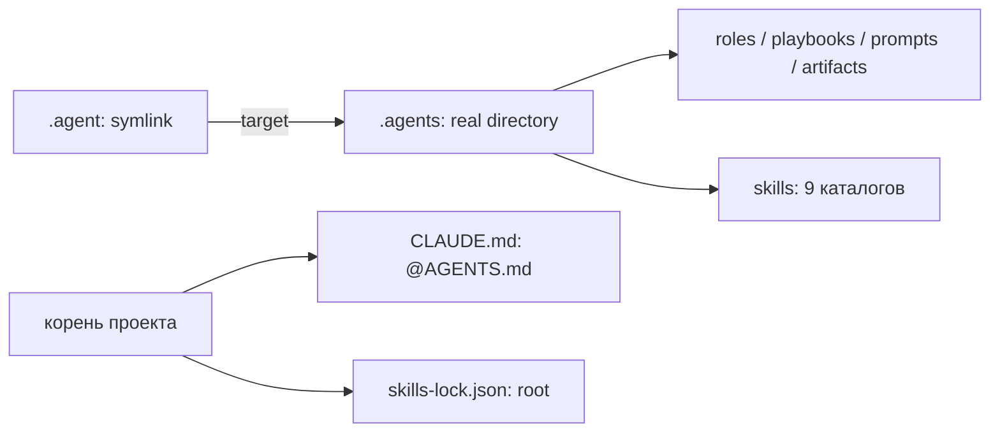

# B2: переносимая структура agent-материалов — предложение

**Статус: требуется явный выбор A/B/C.** Выполнена только read-only инвентаризация. Структура, исходный `.gitignore`, код/config/tests не изменены; данные не удалялись и Git-индекс не менялся. Ранее полученное разрешение cleanup C/D сохранено, но порядок текущего запроса — B2 первым, затем B1/B3. До выбора B2 никакой миграции.

## 1. Текущее состояние



`lstat` и `file -h` подтверждают `.agent -> .agents`; это относительная ссылка. Обычный `file` в этой среде следует ссылке и печатает directory для обоих имён, поэтому он сам по себе не определяет тип. Обычный `find .agent` без `-L` показывает только сам symlink; отдельный обход реального дерева сохранён в инвентаризации.

Инвентаризация содержит 1338 SHA256 обычных файлов и 300 внутренних symlink-записей. В разрешённом дереве не обнаружено имён, требующих исключения из чтения по политике закрытых путей; этот факт не является аудитом секретов в произвольных файлах. Ссылки не разыменовывались. Их локальные абсолютные targets нормализованы `${REPO_ROOT}` в отчёте, а исходные строки отдельно защищены SHA256.

### Владение и группы

| Группа | Фактическое содержимое | Обычных файлов |
| --- | --- | ---: |
| Framework — наше | roles, playbooks, prompts, артефакты/приёмочные проверки, кроме выделенных mixed/runtime | 1290 |
| Claude Code / agent skills — внешние, нужные | `.agents/skills/`, 9 каталогов; root `skills-lock.json` остаётся отдельным файлом | 43 + root lock |
| Mixed — наше evidence | 3 файла release_cleanup с обоими написаниями путей | 3 |
| Unclear — не продуктовые исходники | 2 runtime-файла старого `artifacts/g0-build-env`; их происхождение не нужно угадывать, сохраняем | 2 |

Каталог skills действительно используется текущим каталогом навыков среды по пути `.agents/skills`. Это конкретный внешний потребитель, а не предположение о Claude Code. Способ изменения discovery этого внешнего инструмента в репозитории не найден. Перенос директории сохраняет файлы, но сам по себе не доказывает, что внешний инструмент обнаружит новый путь.

`CLAUDE.md` содержит только `@AGENTS.md`: ссылок `.agents/` там нет. Для `skills-lock.json` прочитаны только верхние ключи `version`, `skills`, значения не опубликованы. Не утверждаем, что все внутренние tool-specific значения уже исследованы; предлагается оставить lock на прежнем месте побайтно.

### Живые ссылки в заданных потребителях

| Файл | Совпадений | Вид |
| --- | ---: | --- |
| `AGENTS.md` | 2 | только `.agent/` |
| `workspace/telegram-rag-bot-src/tests/test_hr_acceptance.py` | 2 | только `.agent/` |
| `workspace/telegram-rag-bot-src/tests/test_hr_adapters.py` | 1 | только `.agent/` |

У roles/playbooks/prompts, текущего README.delta и CLAUDE нет совпадений с `.agents/`; не требуется массовая правка markdown. Полные строки/номера: `b2_references.json`. В исходной инвентаризации, до создания B2-отчётов, 5 md/json/yaml файлов с `.agents/` — все являются историческими cleanup-инвентаризациями/предложением, а не runtime-путями продукта.

## 2. Три варианта

| Вариант | Структура | Плюсы | Ограничения и изменения |
| --- | --- | --- | --- |
| A | `.agent/` real, `.agents -> .agent` | Основной framework получает real dir; существующие `.agent/` ссылки сохраняются | Один symlink остаётся в опубликованном индексе; без поддержки symlink Windows-потребители `.agents/skills` могут не работать. Основные markdown править не нужно. |
| B | `.agents/` real, `.agent -> .agents` | Текущая раскладка и discovery навыков сохраняются, ноль структурных правок | Основной интерфейс framework зависит от symlink. Windows checkout без поддержки ссылок не удовлетворяет переносимости. В индексе остаётся один корневой link. |
| C — рекомендуется | Только `.agent/` real; `.agents` отсутствует | Продуктовые и framework-файлы не требуют symlink для checkout; публичный индекс может иметь 0 symlink-объектов | Внешнему инструменту, который жёстко ищет `.agents/skills`, нужен подтверждённый способ discovery нового пути/новая сессия. Не обещаем, что неизвестный tool умеет конфигурировать этот путь. |

**Рекомендация: C**, если приоритет — переносимость публичного дерева и канонический интерфейс AGENTS.md/roles. Навыки переносятся в `.agent/skills` без изменения содержимого, lock остаётся в корне. `CLAUDE.md` читается с корня и уже включает AGENTS.md; его менять не требуется. Альтернатива A сохраняет старое имя для tools ценой symlink-зависимости; B остаётся status quo и цель переносимости не устраняет.

Нулевое число symlink-объектов в Git — проверяемая характеристика среза, а не доказательство работы всего Python/FAISS/внешних tools на Windows. Запуск на другой OS здесь ещё не выполнялся.

## 3. Миграция C после выбора

1. Повторно сверить типы и target `.agent/.agents`; убедиться, что вторая запись real directory, первая — именно относительный link `.agents`. При неожиданном real `.agent`, другом target или новых конфликтах — STOP/need_info, не merge/overwrite.
2. Сделать backup **вне репозитория** `/tmp/b2_backup_<timestamp>.tar.gz` и сохранить SHA256 архива. Tar без dereference должен содержать `.agent` как ссылку и `.agents` как реальное дерево. Перед backup повторно исключить появление закрытых путей: если чтение стало запрещено, остановиться, а не обходить ограничение. Дополнительно сохранить manifest файлов/targets и SHA root lock/CLAUDE.
3. Удалить **только корневой symlink** `.agent`, не его target. Переместить `.agents` в свободное имя `.agent` в пределах одного filesystem. Это переименование всего дерева, не копирование/слияние: внутренние данные не удаляются. Проверить результат сразу; в случае ошибки использовать backup/восстановить исходную связь без overwrite чужого destination. При конфликте остановиться.
4. Побайтно сверить каждый первоначальный обычный файл по новой префиксной карте `.agents/... -> .agent/...`; отдельно сверить внутренние targets/modes и наличие всех 9 skills-каталогов. Разрешённые содержательные изменения после сохранения исходников — только README.delta, .gitignore и служебные metadata/status этой операции. Не менять исторические snapshots/manifests/acceptance `.py` ради новых путей.
5. Дописать русский раздел «Структура проекта / Project structure» в README.delta с real `.agent/{roles,playbooks,prompts,artifacts,skills}`, root CLAUDE/lock. Lock не переносить и не редактировать: tool-specific совместимость требует сохранить его root location и hash. CLAUDE остаётся `@AGENTS.md`.
6. Применить полный `b2_gitignore_C.proposed`: сохранить уже согласованные cleanup-правила, убрать дубли `.agents/artifacts/...`, оставить canonical `.agent/...` и добавить семь точечных runtime-исключений из §4. Это будет новая согласованная версия ignore для C; последующий cleanup **не должен вернуть старый текст**, иначе потеряются дополнительные защиты. До явного выбора C исходный ignore не меняется.
7. Сохранить миграционный отчёт/проверки. Не удалять содержимое artifact storage в фазе B2. Удаление 15 C-целей — отдельное действие cleanup только после его собственного повторного size/composition preflight.

При A аналогично переносится real directory, затем создаётся обратная относительная ссылка `.agents -> .agent`; публичный index ожидает ровно один корневой link. При B данные остаются на месте; ignore правила должны использовать реальное `.agents` дерево, а не путь за `.agent`-ссылкой. Никакие дополнительные локальные links автоматически не удаляются.

## 4. Внутренние symlink и публикация

300 link-записей относятся к старым pytest fixtures/указателям `*current` и окружению сборки. По предыдущему proposed ignore закрываются 157, **143 остаются не закрыты**. Конкретные дополнительные директории:

| Каталог текущего дерева | Symlink-записей вне прошлого ignore |
| --- | ---: |
| `.agents/artifacts/backend_rest_adapters_checks/reviewer2_tmp` | 11 |
| `.agents/artifacts/backend_rest_adapters_checks/reviewer_race_tmp` | 1 |
| `.agents/artifacts/g0_reaudit/pytest_temp` | 22 |
| `.agents/artifacts/reviewer_core_tmp` | 22 |
| `.agents/artifacts/reviewer_core_final_tmp2` | 42 |
| `.agents/artifacts/reviewer_core_final_tmp` | 42 |
| `.agents/artifacts/g0-build-env` | 3 |

Для C предлагаются соответствующие точечные `.agent/artifacts/.../` ignore-правила. Это **ignore-only, не удаление**; ни acceptance `*_checks/*.py`, ни snapshots/coverage/review/patch не исключаются общим правилом. Все старые файлы и link-строки остаются на диске. Их возможные targets со старым `.agents` в неиспользуемых fixtures становятся историческими, не runtime-интерфейсом продукта.

Полный C-ignore (дубликат для проверки перед выбором; ещё не применён):

```gitignore
# Секреты: шаблон примера разрешён, рабочие значения не публикуются.
.env
.env.*
!.env.example
!**/.env.example
*.pem
*.key
secrets/

# Python: окружения, кэши и результаты сборки.
.venv/
__pycache__/
*.pyc
*.pyo
*.egg-info/
build/
dist/
.pytest_cache/
.mypy_cache/
.ruff_cache/
htmlcov/
*.coverage
/.coverage
/.coverage.*
/coverage.json
*.whl
*.tar.gz

# Локальные результаты прогонов и FAISS; product analytics/*.py остаются.
/artifacts/
/.faiss_indices/
analytics/unanswered.jsonl

# Транзиентные agent-файлы: вариант C, canonical real directory .agent/.
.agent/artifacts/**/tmp*/
.agent/artifacts/**/reviewer_tmp*/
.agent/artifacts/**/__pycache__/
.agent/artifacts/**/*.pyc
.agent/artifacts/**/.coverage*
.agent/artifacts/**/test_report.xml
.agent/artifacts/**/coverage_run.log
.agent/artifacts/**/*.log

# Reference-клоны остаются локально. Forked source здесь не исключается.
/workspace/telegram-rag-bot/
/workspace/multi-llm-orchestrator/
/workspace/sirchatalot-reference/

# IDE/OS и локальные настройки инструментов; решение D перед применением.
.idea/
.vscode/
.DS_Store
*.swp
*.swo
/.codex/
/.claude/

# B2: точечные исключения старых temp/build-каталогов; данные не удаляются.
.agent/artifacts/backend_rest_adapters_checks/reviewer2_tmp/
.agent/artifacts/backend_rest_adapters_checks/reviewer_race_tmp/
.agent/artifacts/g0_reaudit/pytest_temp/
.agent/artifacts/reviewer_core_tmp/
.agent/artifacts/reviewer_core_final_tmp2/
.agent/artifacts/reviewer_core_final_tmp/
.agent/artifacts/g0-build-env/
```

Изолированная pathname-only модель C-ignore проверена без staging: все300 внутренних link-путей исключены, все10 критических сохраняемых путей (acceptance, snapshots, skills, roles, coverage/review, config и source) не игнорируются. Результат: `b2_ignore_preview.json`. Это проверка правил, не фактическая проверка Git-index после миграции.

Буквальное `find . -type l` по всему локальному проекту **не станет пустым**: остаются старые ignored fixtures, virtualenv и reference-клоны, которые запрещено удалять в B2. Проверки для переносимости C: `.agent/.agents` не являются symlink, `find` agent-root links пуст, **в изолированном публичном Git index нет mode120000**. Не выдаём эти проверки за отсутствие любых ссылок на локальном диске.

## 5. Исторические `.agents/` ссылки и scopes

Нельзя запускать общий sed по snapshots, ранее подписанным manifests, архивным patch/review или текстам исходников, сохранённым в evidence: это перепишет историю и может сломать acceptance-проверки. Исторические исключения:

- `release_cleanup/{classification.md,proposal.md,inventory_before.json,ignore_preview.json,path_classification.json}` — зафиксированное до-B2 состояние;
- собственные `publication_prep/b2_inventory.json`, `b2_references.json`, `b2_link_audit.json`, это предложение — инвентаризация/сравнение вариантов, а не активная настройка;
- snapshots/checks backup copies, если grep найдёт в них сохранённые исторические строки: документировать отдельно, не править их автоматически.

В активных framework markdown и тестовых путях уже используется `.agent/`. После C требование «0 `.agents/` в markdown» означает **0 активных потребителей**, а не уничтожение исторических упоминаний в этих перечисленных отчётах. Если появятся новые активные `.agents/` ссылки — STOP до согласования конкретных файлов.

## 6. Проверки после реализации и порядок B1/B3

- Корневые типы/targets, backup вне repo, все исходные файлы и внутренние link targets сохранены; root lock/CLAUDE hash прежний.
- Frozen 44/44 + i18n8/8 по фактическому accepted snapshot без правок source/config/tests; G2status остаётся неизменным.
- Локальные source tests и coverage через существующую среду: ожидаем прежние316/3 и2238/2869=78.006273963%. Basetemp/coverage в `/tmp`, чтобы не создавать новые repo-transient; не запускать source `tests/load_test.py` (import-time доступ к credential files).
- Simulated clone в отдельном `/tmp/b2_clone_test`, только безопасный Git-public срез, без ссылок на общий индекс/чужие проекты, без .venv/reference/audit/secrets. Staging разрешён **только в копии**. Для C ожидается0 mode120000; для A/B — один root link. Backup/сравнение данных и Git mode audit — разные проверки.
- Полный suite в чистом клоне **сейчас** зависит от B1: два core-hash теста напрямую читают ignored audit copy. Не обещаем316/3 в audit-free клоне до B1. По заданному порядку сначала структурная B2-проверка, затем отдельно разрешённый B1, после него повторный clean-clone suite. Это явный pending verification, не скрытый skip/подгонка тестов.
- После B2 можно параллельно вести B1 (только разрешённый тест+JSON+README) и read-only B3. У них общий README.delta, поэтому правки этого документа должны интегрироваться последовательно, без потери изменений. B3 KEEP/UNSTAGE остаётся отдельным approval gate; индекс общего Git до него не меняется.
- Полученное approval cleanup C/D не является выбором B2 и не разрешает KEEP/UNSTAGE B3. Перед удалением разрешённых15C повторяются размеры/состав с proposal и при расхождении STOP. Новые семь temp-каталогов из §4 не включены в разрешённое удаление.

Реальные Docker/K8s/Telegram/LLM/HTTP не запускаются. Ни git add/commit/push в оригинале, ни исправление protected core не входят в B2. G2 не закрывается.

## 7. Риски и точка решения

- Внешний discovery навыков: найден текущий concrete `.agents/skills` consumer; C сохраняет данные, но может требовать перенастройки инструмента или новой сессии. Config-способ не выдумывается, домашние настройки не редактируются. Не создавать совместимый symlink молча после выбора C.
- Потеря данных: предотвращается внешним backup, atomic tree rename, проверкой hash/target-карты; неожиданный merge-конфликт — need_info, не auto-merge.
- Snapshot/provenance: разрешены только явно перечисленные исторические упоминания старых путей, содержимое не переписывается.
- Игнорирование: точечные семь правил защищают Git-index от дополнительных runtime-links и ничего не удаляют.
- Переносимость: доказательство на текущей OS — структура/режимы index; фактический запуск внешних tools и Windows не проверен.

**STOP. Выберите явно A, B или C. Рекомендуется C с точечными ignore-правилами и сохранением исторического evidence, как описано выше.** Ни один вариант пока не реализован.
