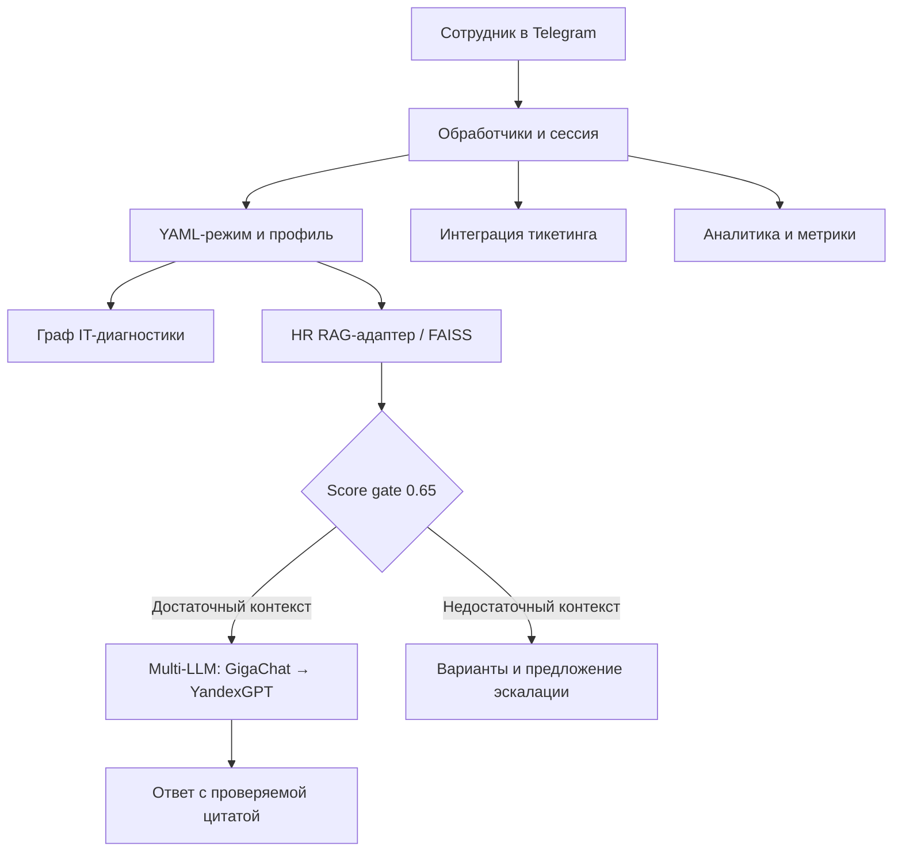

# Onboarding Navigator — HR-бот для Telegram

[](workspace/telegram-rag-bot-src/pyproject.toml)
[](#-тестирование)
[](#-тестирование)
[](workspace/telegram-rag-bot-src/LICENSE)

> Telegram-ассистент для онбординга и HR-поддержки сотрудников: ответы по базе знаний, персональные планы, IT-самодиагностика и эскалация в поддержку.

## 📖 Содержание

- [Возможности](#-возможности)
- [Быстрый старт](#-быстрый-старт)
- [Работа с ботом](#-работа-с-ботом)
- [Docker и Kubernetes](#-docker-и-kubernetes)
- [Архитектура](#-архитектура)
- [Настройка и новые режимы](#-настройка-и-новые-режимы)
- [Тестирование](#-тестирование)
- [Производительность и ожидающие проверки](#-производительность-и-ожидающие-проверки)
- [Ограничения](#-ограничения)
- [Решение проблем](#-решение-проблем)
- [Документация и лицензия](#-документация-и-лицензия)

## ✨ Возможности

| Возможность | Что делает бот                                                                                           |
| --- |----------------------------------------------------------------------------------------------------------|
| Пять YAML-режимов | IT-поддержка, льготы, обучение, культура и план онбординга; новые режимы добавляются без правок Python   |
| Персональный онбординг | Подбирает план по роли и отделу сотрудника                                                               |
| RAG на FAISS | Ищет ответы в Markdown-базе знаний; при similarity ниже 0.65 предлагает до трёх вариантов и эскалацию    |
| Проверяемые цитаты | Показывает источник и дословную цитату из контекста; сообщает, если основание недоступно                 |
| IT-самодиагностика | Проводит по YAML-графу VPN/почты без LLM, с возможностью эскалации на любом шаге                         |
| Multi-LLM fallback | Использует GigaChat с фоллбеком на YandexGPT                                                             |
| Тикетинг | Поддерживает явную эскалацию и автоматическую после двух RAG fallback подряд                             |
| Администрирование | Предоставляет `/reindex` и `/status` пользователям из `ADMIN_IDS`                                        |
| Метрики и аналитика | Считает LLM-запросы, RAG-оценки, fallback и результаты создания тикетов; записывает неотвеченные вопросы |
| Локализация | Русские строки вынесены в YAML; механизм подготовлен к расширению, английский перевод не входит в выпуск |

## 🚀 Быстрый старт

### 1. Установите адаптированные исходники

Нужен **Python 3.11+**. Все команды выполняйте из корня этого репозитория: здесь находятся продуктовый конфиг, режимы и пакеты интеграций.

```sh
python -m venv .venv
source .venv/bin/activate
python -m pip install -e workspace/telegram-rag-bot-src/
```

В Windows PowerShell активируйте окружение через `.venv\Scripts\Activate.ps1`. Для локальных embeddings доступна дополнительная установка `python -m pip install -e 'workspace/telegram-rag-bot-src[local]'`; загрузка модели требует ресурсов и доступа к её источнику.

### 2. Подготовьте переменные окружения

Передайте значения через окружение процесса или используемый вами менеджер секретов:

| Переменная | Назначение |
| --- | --- |
| `TELEGRAM_TOKEN` | Токен Telegram-бота |
| `GIGACHAT_KEY` | Доступ к GigaChat |
| `YANDEX_API_KEY` | Доступ к YandexGPT |
| `YANDEX_FOLDER_ID` | Идентификатор каталога Yandex Cloud |
| `ADMIN_IDS` | JSON-список числовых Telegram ID администраторов |
| `TICKETING_WEBHOOK_URL` | Адрес интеграции с тикетингом |
| `HR_CHAT_ID` | Идентификатор HR-чата |

### 3. Запустите бота

В активированном окружении, из корня репозитория:

```sh
python -m telegram_rag_bot run
```

Подкоманда `run` обязательна: вызов модуля без аргументов выводит справку. Приложение читает `config/config.yaml` относительно текущего каталога. В локальной конфигурации HTTP-сервер использует порт **8000** по умолчанию; образ и Kubernetes настроены на **8080**.

## 💬 Работа с ботом

1. Откройте бота в Telegram и отправьте `/start`.
2. Отправьте `/mode`, чтобы увидеть доступные режимы.
3. Выберите, например, `/mode onboarding_plan` и отправьте сообщение для начала сбора профиля.
4. Ответьте на запросы роли и отдела: например, `developer` и `engineering`. Используйте строчные значения, безопасные для имён путей.

`/start` сам по себе не собирает профиль. Для других сценариев выбирайте `/mode it_support`, `/mode benefits`, `/mode learning` или `/mode culture`.

| Команда | Назначение |
| --- | --- |
| `/start` | Начало работы |
| `/mode` | Список режимов |
| `/mode <имя>` | Выбор режима |
| `/status` | Статус для администратора |
| `/reindex` | Переиндексация существующих режимов для администратора |

## 🐳 Docker и Kubernetes

Следующие команды предназначены для воспроизведения в реальном окружении.

### Docker

```sh
docker build -t onboarding-navigator .
docker run --rm --env-file .env -p 8080:8080 onboarding-navigator
```
healthcheck
```sh
curl -f http://127.0.0.1:8080/health
```

Ожидаемый результат — HTTP 200. Multi-stage образ использует Python 3.13 и пользователя `app` с uid 1000. Build-time overlay включает HTTP 8080 только в копии конфига внутри образа; исходный `config/config.yaml` не меняется.

### Kubernetes

Сначала сделайте образ `onboarding-navigator:latest` доступным узлам кластера либо укажите в манифесте доступный образ из вашего registry. Создайте Secret `telegram-secrets` с семью ключами из таблицы окружения через принятый у вас механизм управления секретами.

```sh
kubectl create secret generic telegram-secrets \
  --from-literal=TELEGRAM_TOKEN="$TELEGRAM_TOKEN" \
  --from-literal=GIGACHAT_KEY="$GIGACHAT_KEY" \
  --from-literal=YANDEX_API_KEY="$YANDEX_API_KEY" \
  --from-literal=YANDEX_FOLDER_ID="$YANDEX_FOLDER_ID" \
  --from-literal=ADMIN_IDS="$ADMIN_IDS" \
  --from-literal=TICKETING_WEBHOOK_URL="$TICKETING_WEBHOOK_URL" \
  --from-literal=HR_CHAT_ID="$HR_CHAT_ID"
```

Эта команда передаёт значения в аргументах процесса. Для окружений, где это недопустимо, используйте ваш менеджер секретов. Затем примените манифест:

```sh
kubectl apply -f deploy/k8s/deployment.yaml
kubectl rollout status deployment/onboarding-navigator --timeout=120s
kubectl get pods -l app=onboarding-navigator
```

Ожидаемый результат — **1/1 Running**. Манифест содержит ConfigMap, Deployment и ClusterIP Service. Одна реплика запрашивает 1 CPU / 2 GiB, лимиты — 2 CPU / 4 GiB. ConfigMap заменяет только основной конфиг через `subPath`; режимы и локаль остаются встроенными в образ. `/data` размещается в `emptyDir`, корневая файловая система доступна только для чтения.

## 🏗️ Архитектура



HR-адаптеры делают проверку сходства, цитирование, диагностику и продуктовые сценарии. Основной пакет находится в `workspace/telegram-rag-bot-src/`, интеграция тикетинга — в `integrations/`, запись аналитики — в `analytics/`.

### Структура проекта

```text
workspace/telegram-rag-bot-src/   # Адаптированный пакет и его тесты
config/
  config.yaml                   # Настройки продукта
  i18n/ru.yaml                  # Русская локаль
  modes/                        # Пять наборов режимов
integrations/                   # Тикетинг
analytics/                      # Запись неотвеченных вопросов
deploy/                         # Build-time overlay и Kubernetes
tests/load/run_baseline.py       # Воспроизводимый нагрузочный runner
Dockerfile
```

## 🛠️ Настройка и новые режимы

Основные настройки находятся в [config/config.yaml](config/config.yaml): каталог режимов, порог RAG, провайдеры LLM, TTL сессии, тикетинг и локаль. Чувствительные значения задаются через `${...}` placeholders.

Для нового режима создайте каталог:

```sh
mkdir -p config/modes/my_mode
```

Добавьте `mode.yaml`:

```yaml
name: my_mode
display_name: Новый режим
description: Ответы по новой базе знаний
enabled: true
files:
  system_prompt: system_prompt.md
  faq: faq.md
timeout_seconds: 30
source_titles:
  faq.md: База знаний нового режима
```

Рядом разместите `system_prompt.md` и `faq.md` в UTF-8. За образец возьмите [IT-поддержку](config/modes/it_support/mode.yaml). Необязательные `diagnostics_file` и `plans_directory` подключают граф диагностики и каталог планов соответственно.

**Перезапустите приложение для обнаружения нового режима.** `/reindex` обновляет материалы уже известных режимов, но не обнаруживает новые определения. Для встроенных в контейнер материалов нужны пересборка и повторное развёртывание. Python-код менять не требуется.

## 🧪 Тестирование

Последний локальный прогон: **317 passed / 3 skipped**, покрытие **78.006%** — 2238 из 2869 statements. Набор тестов включает проверку обнаружения изменения защищённого файла.

Установите инструменты разработки в активированное окружение:

```sh
python -m pip install -e 'workspace/telegram-rag-bot-src[dev]'
```

Из корня репозитория:

```sh
python -B -m pytest workspace/telegram-rag-bot-src/tests \
  --ignore=workspace/telegram-rag-bot-src/tests/load_test.py \
  --cov=telegram_rag_bot \
  --cov-config=workspace/telegram-rag-bot-src/pyproject.toml \
  --cov-report=term-missing --cov-fail-under=78 \
  -q -p no:cacheprovider
```

Исторический `load_test.py` исключён: он обращается к файлам учётных данных при импорте и не предназначен для этого модульного прогона.

### Проверка защищённого ядра

Четыре baseline SHA-256 находятся в [protected_core_hashes.json](workspace/telegram-rag-bot-src/tests/data/protected_core_hashes.json). Два защищённых файла входят в исходники, два принадлежат зависимости orchestrator. В чистом клоне установленная зависимость находится через `importlib`, без audit-копии.

```sh
python -B -m pytest workspace/telegram-rag-bot-src/tests/test_hr_adapters.py \
  -k 'protected_core or audit_detects_modification' -q -rs
```

При отсутствии orchestrator изолированная проверка выполняется с `--noconftest`: два dependency-теста явно пропускаются, два source-теста продолжают проверять хеши. Полный suite требует установленных зависимостей приложения.

## 📊 Производительность и ожидающие проверки

| Проверка | Цель | Текущий статус |
| --- | --- | --- |
| Telegram e2e | Telegram e2e p95 ≤ 3000 мс | Нужны реальный мост завершения Telegram-запросов и нагрузочное окружение |
| RAG | RAG p95 ≤ 200 мс | Заблокирован: в приложении нет `/debug/rag_latency`; нужен отдельный PR или внешнее профилирование |
| Docker | Сборка и запуск Docker, HTTP 200 | Нужен реальный Docker daemon |
| Kubernetes | Kubernetes pod 1/1 Running | Нужны кластер, доступный образ и Secret |

Runner позволяет подготовить выборку без сети:

```sh
python tests/load/run_baseline.py --dry-run --seed 0 --out artifacts/dry_run
```

Dry-run не измеряет задержку. Для замера Telegram e2e нужен внешний мост: POST `{request_id, mode, query}` должен вернуть совпадающий `request_id` и `telegram_e2e_completed: true` только после фактического завершения ответа Telegram. Обычного подтверждения приёма webhook недостаточно. Приложение само такой мост не предоставляет.

После подготовки моста и нагрузочного окружения:

```sh
python tests/load/run_baseline.py --target-url "<REAL_URL>" \
  --rps 10 --duration 300 --samples 1000 --seed 0 \
  --telegram-e2e --out artifacts/telegram_e2e
```

Замените `<REAL_URL>` адресом моста. Ожидаемая цель в `artifacts/telegram_e2e/summary.json` — `p95_telegram_e2e_ms <= 3000`. Режим `--rag-only` завершается с кодом 2: endpoint `/debug/rag_latency` отсутствует, поэтому RAG-задержку нужно измерять после отдельного расширения приложения или внешним профилировщиком.

## ⚠️ Ограничения

- Устранение дублей тикетов действует в пределах процесса; между pod идемпотентность не гарантируется.
- Redaction чувствительных данных эвристический и не гарантирует удаления всех таких данных.
- Резервное хранение сессий в памяти локально процессу и не заменяет общее хранилище.
- `emptyDir` не обеспечивает долговременного хранения аналитики и индексов.
- Календарь, голос, английский перевод, аналитический UI и HR-аутентификация не входят в текущий объём работ.
- Реальные build/deploy и целевые задержки остаются непроверенными; локальные тесты их не заменяют.

## 🐛 Решение проблем

| Симптом | Что проверить |
| --- | --- |
| Вместо запуска появляется справка | В команде должна быть подкоманда `run` |
| Не найдены конфиг или корневые интеграции | Запускайте из корня репозитория после editable-установки форка |
| Бот не отвечает | Проверьте доступность Telegram и передачу токена в окружение процесса; не выводите токен в логи |
| Локальная health-проверка на 8080 не отвечает | Локальный конфиг использует 8000; порт 8080 задаётся в образе и Kubernetes |
| Новый режим не появляется после `/reindex` | Перезапустите приложение; для контейнера пересоберите образ |
| `--rag-only` завершается с кодом 2 | Endpoint для отдельного измерения RAG отсутствует |

## 📚 Документация и лицензия

- [Документация исходного telegram-rag-bot](workspace/telegram-rag-bot-src/README.md)
- [Конфигурация продукта](config/config.yaml)
- [Пример YAML-режима](config/modes/it_support/mode.yaml)
- [Dockerfile](Dockerfile) и [манифест Kubernetes](deploy/k8s/deployment.yaml)
- [Нагрузочный runner](tests/load/run_baseline.py)
- [Лицензия исходного проекта](workspace/telegram-rag-bot-src/LICENSE)

**Upstream:** telegram-rag-bot 0.14.6, автор **MikhailMalorod**, лицензия **MIT**. Onboarding Navigator — HR-расширение этого проекта. Уведомления об авторских правах и разрешении должны сохраняться при дальнейшей поставке и форках согласно условиям лицензии.

## License

This project is licensed under the **MIT License** - see [LICENSE](LICENSE) for the full text.
